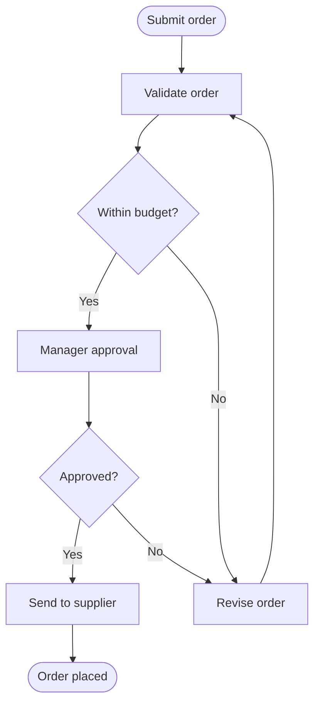

<h1 align="center">Merlive</h1>
<h3 align="center">Your Mermaid diagrams, placed by rule and made live.</h3>

<table align="center">
  <tr><th>Mermaid</th><th>Merlive</th></tr>
  <tr>
    <td align="center"></td>
    <td align="center"></td>
  </tr>
</table>
<p align="center"><sub>One Mermaid block, drawn twice. Nobody edited it and nobody placed a box.</sub></p>

<p align="center"><strong>Mermaid is the easy way to write a diagram and an odd way to look at one.</strong> Tell your
coding agent to <em>merlive this document</em>. It keeps your Mermaid as the source, places every box by rule (the
main path straight, boxes of one size, lines that go round boxes), checks those rules, and writes one
self-contained page per flowchart, in your own design, that readers can step through.</p>

<p align="center">
  <a href="https://skills.victorsaly.com/merlive"><strong>See it at work</strong></a> &nbsp;·&nbsp;
  <a href="#start"><strong>Get started</strong></a> &nbsp;·&nbsp;
  <a href="#what-you-get"><strong>What you get</strong></a> &nbsp;·&nbsp;
  <a href="#in-the-mermaid"><strong>In the Mermaid</strong></a> &nbsp;·&nbsp;
  <a href="docs/COVERAGE.md"><strong>What it draws of Mermaid</strong></a> &nbsp;·&nbsp;
  <a href="docs/PLACEMENT.md"><strong>The rules</strong></a>
</p>

<p align="center">
  <a href="https://skills.sh"></a>
  
  <a href="LICENSE"></a>
</p>

> **0.1.0, not released yet.** It draws flowcharts, state diagrams and sequence diagrams. Class, timeline and the
> other diagram kinds are left as Mermaid and named. [What it draws of Mermaid today](docs/COVERAGE.md), feature by feature. [What comes next](docs/ROADMAP.md).

<a id="start"></a>

## Install, then ask

**What it needs:** Node 22 or later. Nothing else: no packages, no browser, no network.

```bash
npx skills add victorsaly/merlive -g
```

Then ask your agent: `Merlive docs/orders.md`. There is nothing to configure: the first time, it reads your
site's own colours and sets itself up.

Or run it yourself:

```bash
node skills/merlive/scripts/merlive.mjs examples/order-approval.md --check   # what would be drawn
node skills/merlive/scripts/merlive.mjs examples/order-approval.md           # examples/diagrams/order-approval-1.html
node skills/merlive/scripts/merlive.mjs examples/order-approval.md --format svg
node skills/merlive/scripts/merlive.mjs --setup --from https://your.site             # your colours, once
```

## What you get

- **A diagram that looks planned.** The main path runs in one straight line and everything else sits to one side.
  Every box is the same size, on a grid. A rhombus, a cylinder or a hexagon is the shape its author drew, in the
  same footprint as the boxes round it, not a diamond twice their size. Lines turn at right angles, each with a port of its own, and go round boxes.
- **Character that means something.** The main path is drawn heavier. A box of a kind carries a stripe of its
  colour. A group sits in a faintly filled frame. Boxes lift off a ground of dots, the grid they are placed on.
  Nothing is decoration, and a site with no shadows gets diagrams with none.
- **Rules that are checked.** Eight placement rules and two for colour run before anything is written. A diagram
  that breaks one is not written, and the message says which rule, where, and what to change.
  [The rules](docs/PLACEMENT.md).
- **Your Mermaid, unchanged.** It stays the thing people edit and still renders anywhere Mermaid does. Steps and
  notes are `%%` comments other renderers ignore.
- **A page readers can use.** Pick a box or a line to see only what it connects to. Walk the steps the author
  wrote. Nothing moves until the reader presses play, and then one dot follows the path.
- **Your colours, without choosing any.** Once for a project, Merlive reads the site your diagrams will sit on
  (the project's own stylesheet, or an address you give): its page, text and accent colours, its face, its corner,
  whether it has a dark mode. It makes the rest a diagram needs from those and writes the settings itself. You
  never type a colour code.
- **And held to account.** Any colours, read or set by hand, pass two rules before a diagram is drawn: words can
  be read, and the kinds of box can be told apart, also by the one man in twelve who does not see red and green
  apart. What setup reads and would fail, it puts right and tells you.
- **Every choice already made, and changeable.** Light, dark or both; how much moves; a page, a picture or both;
  steps, legend and source on or off. Setup shows them on one page; say what you want in your own words.
- **One file, nothing fetched.** The page works offline and prints with its notes as an appendix. `--format svg`
  gives a still picture for wikis.

## In the Mermaid

```
flowchart TD
  A([Submit order]) --> B[Validate order]
  B --> C{Within budget?}
  C -->|No| E[Revise order]
  E --> B
  class E rework

  %% note C: Compares the order total with what is left in the budget.
  %% step: The revision loop | loop 1 | Over budget, so the requester revises and it is validated again.
  %% main: A>B>C
```

`%% note`, `%% step`, `%% main` and `%% side` are all there is. They say what the author means, never where a box
goes. The full list, and the Mermaid that is read, is in [reference.md](skills/merlive/reference.md).

## Three layers

| Layer | Who decides | What |
|---|---|---|
| Rules | Merlive | Where boxes go, their size, how lines run. A design cannot switch them off |
| Design | You, once | Colours, face, corner, motion. Checked, not chosen, by Merlive |
| Hints | The author, per diagram | The main path, the side loops go |

## Working on it

```bash
npm run check      # the tests, with coverage
npm run examples   # draw the examples again
npm run coverage   # run every sample in corpus/ and write docs/COVERAGE.md and corpus/compare.html again
npm run compare    # draw Mermaid's side of corpus/compare.html again (needs mermaid-cli and Chrome)
```

In Visual Studio Code: open a Markdown file with a flowchart in it and press F5 to draw it ("Merlive: draw the
open file"), with the debugger on the command. Right-click the page it writes and choose "Show Preview" to see it
beside the source (the Live Preview extension, which the workspace recommends). The four commands above are
under Terminal, Run Task.

[AGENTS.md](AGENTS.md) says how the code is laid out and written.

## Licence

MIT. Merlive is not affiliated with Mermaid; it reads a part of its flowchart language.
